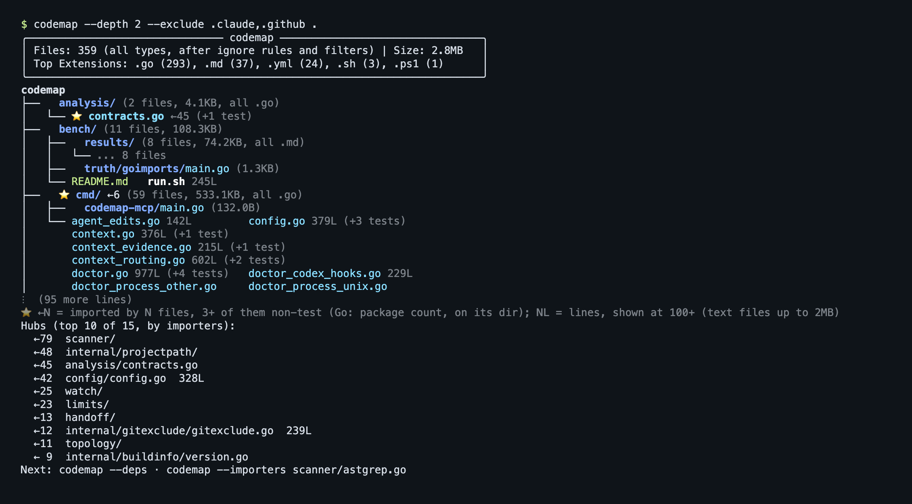

# codemap 🗺️

> **codemap — structural ground truth for coding agents.**
> Resolves what your code actually imports, tells you what breaks if you change it, and is explicit about what it couldn't figure out.


[](https://smithery.ai/skills?ns=jordancoin&utm_source=github&utm_medium=badge)



## Your agent's first minute

```bash
brew tap JordanCoin/tap && brew install codemap   # one static binary
cd your-repo && codemap setup                      # hooks, MCP, and skills for the agents it finds
codemap doctor                                     # verify the wiring
```

Other MCP clients can launch `codemap mcp` (stdio) directly.

After `codemap setup`, the agent gets three answers it cannot get from the source text, at session start, before an edit, and on request.

**Where things are.** `codemap .`

```
╭─────────────────────────────── codemap ────────────────────────────────╮
│ Files: 372 (all types, after ignore rules and filters) | Size: 2.9MB   │
│ Top Extensions: .go (293), .md (45), .yml (29), .sh (3), .ps1 (1)      │
╰────────────────────────────────────────────────────────────────────────╯
codemap
├──   analysis/ (2 files, 4.1KB, all .go)
│   └── ⭐️ contracts.go ←45 (+1 test)
├──   ⭐️ cmd/ ←6 (59 files, 533.1KB, all .go)
│   ...
├──   config/ (2 files, 25.1KB, all .go)
│   └── ⭐️ config.go 328L ←42 (+1 test)
...
⭐️ ←N = imported by N files, 3+ of them non-test (Go: package count, on its dir); NL = lines, shown at 100+ (text files up to 2MB)
Hubs (top 10 of 15, by importers):
  ←79  scanner/
  ←48  internal/projectpath/
  ←45  analysis/contracts.go
  ...
Next: codemap --deps · codemap --importers scanner/astgrep.go
```

**Who depends on this.** `codemap --importers config/config.go`

```
⚠️  HUB FILE: config/config.go
   Imported by 42 files (package codemap/config: Go imports name packages, not files) - changes have wide impact!

   Dependents:
   • blast_radius.go
   • blast_radius_fixes_test.go
   • cmd/config.go
   • cmd/config_more_test.go
   • cmd/config_test.go
   ... and 37 more
   Imports 2 hub(s): internal/projectpath/ (2 files), limits/ (2 files)
Coverage: complete
```

**Where is X defined.** `codemap find "hub importers"` ranks files by path and function/type names, then by body text; hits that matched only in a body are tagged `(body)`. For an exact bug symptom, grep too.

```
importers_go_package_test.go
  matched: importers_go_package_test.go, TestImportersCLIReportsGoPackageGranularity, TestImportersCLIGoPackageHubIsNotAFileHub, TestImportersCommandListsMultiFilePackageImporter
  importers: 0 (of package codemap)
cmd/hooks_test.go
  matched: TestHubInfoIsHub, TestCheckFileImportersOutput, formatFileImportersOutput, TestHubInfoWithMultipleHubs, TestGetHubInfoNoDeps
  importers: 0 (of package codemap/cmd)
main.go
  matched: resolveImportersInvocation, buildImportersReport, runImportersMode, isGitHubURL
  importers: 0 (of package codemap)
...
Coverage: complete
```

Ranked by path and symbol match, each hit tagged with its importer count. Lexical only, and it says so.

**And the one line every answer carries.** Every dependency answer reports a coverage status: `complete`, `partial`, or `unavailable`, with the source that could not be trusted. A partial graph never reads as a complete one, so "nothing imports this" and "I couldn't tell" are different answers. The full contract is in [docs/RESOLUTION.md](docs/RESOLUTION.md#the-coverage-contract).

## What it's for

An agent reading your repo can see what a file *says*. It can't cheaply see what depends on that file. That answer lives in `go.mod`, Cargo workspace membership, `package.json` `exports` maps, and `tsconfig` path aliases, not in the source text.

codemap computes three things:

| | |
|---|---|
| **Orientation** | A structure map with the most-imported files called out. Cheap cold start, useful when an agent has no memory of the last hour. |
| **Dependency graph** | Imports resolved through each ecosystem's real rules, not string matching. |
| **Blast radius** | Who breaks if you change this file. |

## Install

```bash
# macOS/Linux
brew tap JordanCoin/tap && brew install codemap

# Windows
scoop bucket add codemap https://github.com/JordanCoin/scoop-codemap
scoop install codemap
```

Tarballs, CI, and what `codemap setup` writes: [docs/INSTALL.md](docs/INSTALL.md).

## Commands

```bash
codemap .                   # structure view
codemap --diff              # what changed vs main
codemap --deps .            # dependency flow
codemap --importers <file>  # who imports a file
codemap blast-radius        # review bundle: diff + deps + importers
codemap find "<query>"      # where is X defined
codemap handoff .           # save a handoff for the next agent
codemap doctor              # validate agent integrations
```

## Agent integration

- **Hooks**: automatic context at session start, before and after edits, and at compaction. [docs/HOOKS.md](docs/HOOKS.md)
- **MCP**: `codemap mcp` serves 19 tools over stdio. [docs/MCP.md](docs/MCP.md)
- **Codex**: `codemap setup` configures it; trust the hooks once from `/hooks`. [docs/MCP.md](docs/MCP.md#codex)

## Go deeper

| I want to | Read |
|-----------|------|
| install in CI or from a tarball | [docs/INSTALL.md](docs/INSTALL.md) |
| wire up my agent | [docs/HOOKS.md](docs/HOOKS.md) |
| trust the dependency numbers | [docs/RESOLUTION.md](docs/RESOLUTION.md) |
| see every flag and mode | [docs/COMMANDS.md](docs/COMMANDS.md) |
| tune what the agent sees | [docs/CONFIG.md](docs/CONFIG.md) |
| use the MCP tools or Codex | [docs/MCP.md](docs/MCP.md) |
| add a language | [CONTRIBUTING.md](CONTRIBUTING.md#adding-a-new-language) |

## Roadmap

Shipped: diff/skyline/deps modes, project config, Claude + Codex hooks and MCP, cross-agent handoff, remote repos, intent routing, skills framework, context protocol, HTTP API, build-system-aware resolution for Go/Rust/JS/TS, and the versioned coverage contract.

Next:

- [ ] Per-query coverage — report only the gaps that affect *this* answer, not the whole scan ([#111](https://github.com/JordanCoin/codemap/issues/111))
- [ ] Per-edge provenance — which resolver produced each edge, so "why does codemap think A imports B?" is answerable
- [ ] Community skill registry (`codemap skill add <name>`)
- [ ] Enhanced analysis (entry points, key types)

## Peers

[sem](https://github.com/Ataraxy-Labs/sem) does symbol-level impact analysis. [serena](https://github.com/oraios/serena) and [codebase-memory-mcp](https://github.com/DeusData/codebase-memory-mcp) are broader MCP servers with semantic retrieval, and [zvec-grep](https://github.com/zvec-ai/zvec-grep) is hybrid search. codemap's difference: imports resolved through each ecosystem's real rules, a coverage status on every answer, and hub warnings before an edit.

## Contributing

Fork → branch → commit → PR. See [CONTRIBUTING.md](CONTRIBUTING.md) before adding a new language.

## License

MIT
